# cubetimer

[](https://github.com/thomasmartinoa/cubetimer/actions/workflows/ci.yml)

A full-screen speedcubing timer for your terminal. Big ASCII digits, the WCA 15-second
inspection, hold-and-release start like a Stackmat, WCA-style scrambles with a preview of
the scrambled cube for 2x2 to 7x7, and live ao5 / ao12 / ao100 stats.

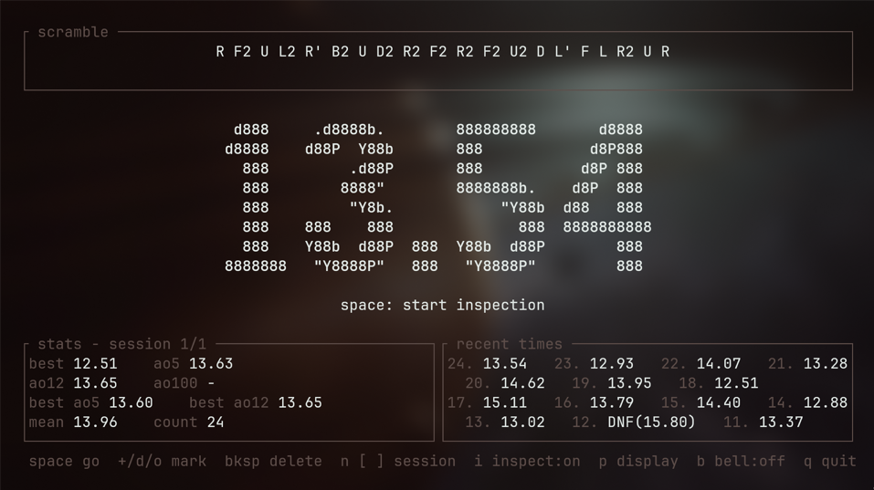

Built for [kitty](https://sw.kovidgoyal.net/kitty/) and written in Rust with
[ratatui](https://ratatui.rs). Apart from the cube preview, which shows the real sticker
colors, it only uses your terminal's ANSI colors, so it picks up whatever theme you
already run.

## Features

- **Hold to start.** Hold space until the display turns green, release to start the
  clock, press any key to stop. Needs the kitty keyboard protocol for release events;
  without it a space press starts and stops the timer (see [Other terminals](#other-terminals)).
- **WCA inspection.** A 15 to 1 countdown with warnings at 8 s and 12 s (and an optional
  terminal bell). Starting after 15 s is a **+2**, after 17 s a **DNF**.
- **Honest time formatting.** Single solves are truncated to hundredths and averages are
  rounded, as in the WCA regulations and csTimer. 12.349 shows as `12.34`; a +2 shows as
  `14.34+`; a DNF in the list keeps its raw time, `DNF(12.34)`.
- **2x2 to 7x7.** Press `e` to pick the cube. Each puzzle has its own sessions and stats,
  and its own kind of scramble, made the way the WCA's official scrambler (TNoodle) makes
  it. See [Scrambles](#scrambles).
- **Scramble preview.** A colored net of the scrambled cube at every size, so you can check
  you scrambled it right.
- **3D cube.** `v` shows the scrambled cube in 3D: drag it with the mouse or the arrow keys
  to look at every side, and press space to watch the scramble being done move by move.
  A real image in kitty, Ghostty, foot and WezTerm, half blocks elsewhere, or ASCII art in
  any terminal (`m` switches). See [The 3D view](#the-3d-view).
- **CFOP algorithms.** `a` opens every PLL, OLL and F2L case (and the beginner 2-look
  sets) as a diagram with a standard algorithm; watch any of them on the 3D cube, mark what
  you are learning, and drill those cases with the trainer. See
  [Algorithms and the trainer](#algorithms-and-the-trainer).
- **Live stats.** Best, mean, mo3, ao5, ao12, ao100, best ao5 and best ao12. The average
  drops the best and worst 5% (at least one each) and a DNF counts as the worst result.
- **Statistics.** Press `s` for a full-screen view: a time chart with rolling ao5 and ao12,
  every new personal best marked, DNFs and very slow solves flagged, round axis values, and
  the chart can cover the last 50, 100, 500 or all solves. Beside it a histogram of your
  times and a summary: solves with their +2 and DNF counts, best, worst, mean, standard
  deviation, and current and best ao5, ao12, ao50, ao100 and ao1000.
- **History.** Press `h` to browse every solve: its time, when it was done, its scramble
  and cube, and the same chart of the session with the solve marked. Mark any solve +2, DNF
  or OK, or delete it.
- **Sessions.** Everything is saved after every change; start a new session, flip
  between them, or delete one.
- **Your data is yours.** `cubetimer --export` prints every solve as CSV for a
  spreadsheet or another timer.
- **Personal best flash.** Beat your best single and the time blinks.
- **Digits sized to your window.** The default `auto` mode keeps the time at about half
  of the available height: not huge, not tiny, at any window size. Press `f` to
  pick a specific style instead, see [Digit fonts](#digit-fonts).
- **Fits any window.** If the font you picked doesn't fit, the next smaller one is used,
  and the layout shrinks to a few text lines in very small windows.
- **Remembers your setup.** The font, inspection and bell settings are saved.
- **Settings.** `,` opens a settings screen: hold time (0 to 1 s, default 0.3 s), inspection,
  0.01 or 0.001 precision, the bell, the digit font and the 3D look. Everything is saved.
- **Names, comments, clipboard.** `r` names the session ("one-handed"), `c` in the history
  comments a solve, and `y` copies the scramble (in the history, the selected solve; in the
  statistics, the last ao5, or `Y` for ao12 written out as
  `(12.10) 13.20 14.00 13.80 (16.43) = 13.67`) to the clipboard through the terminal.
- **csTimer import.** `cubetimer --import export.txt` adds a csTimer export, with its
  sessions, puzzles, penalties, comments and dates.
- **Safe with your data.** Saves are atomic, a damaged file is set aside instead of
  overwritten, only one copy can run at a time, and the terminal is restored however the
  program ends (quit, crash, `kill`, closed window).

| Inspection (8 s warning) | Ready to start | Running |
|---|---|---|
| 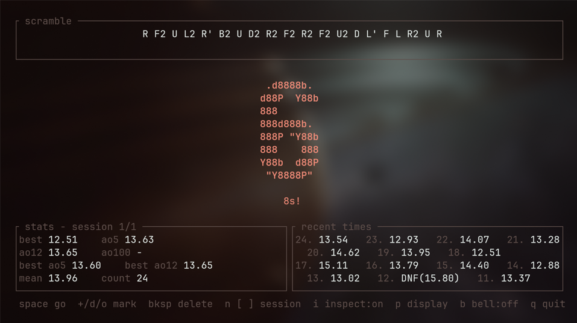 | 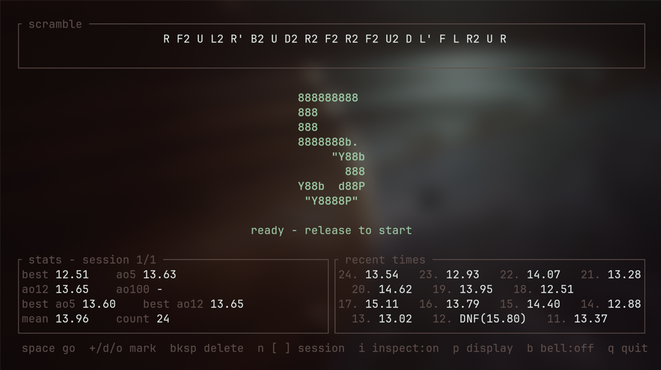 | 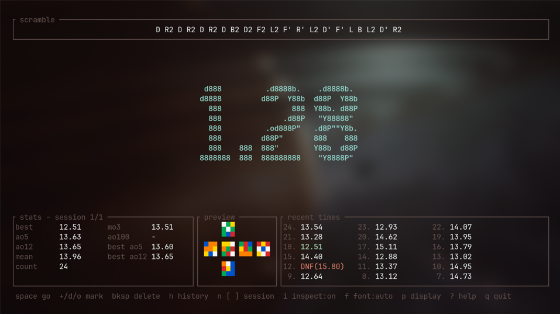 |

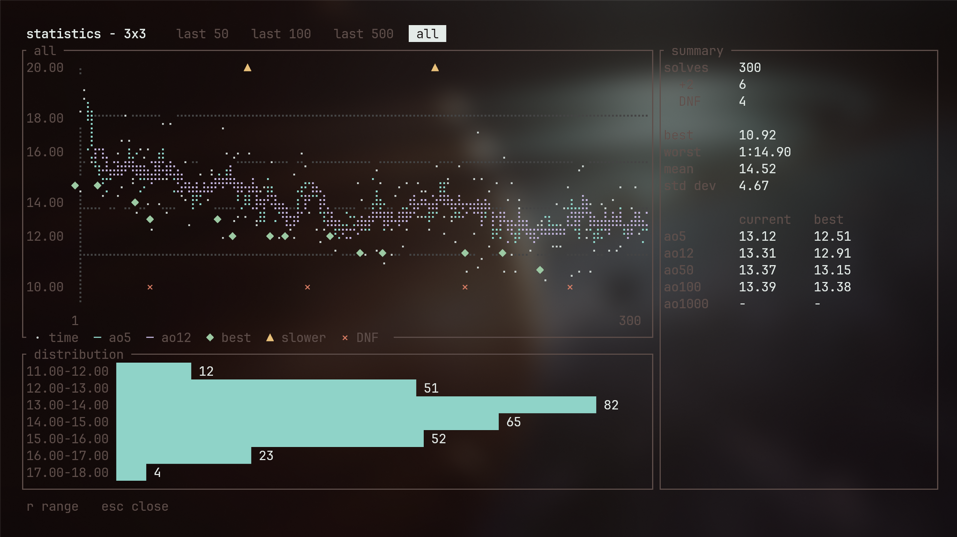

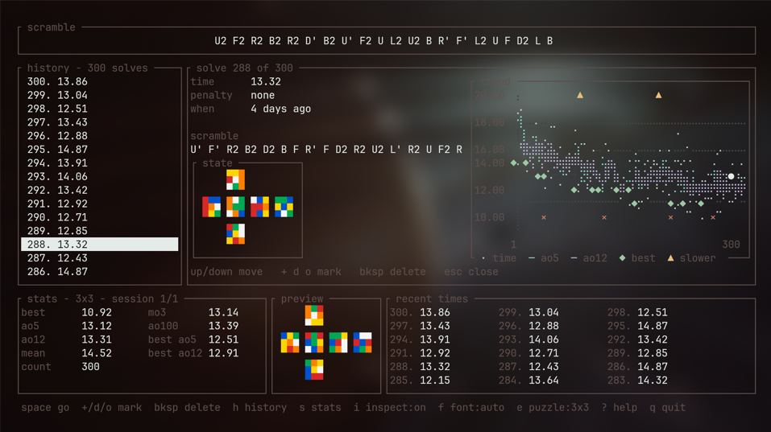

## Install

### Arch Linux (AUR)

Coming Soon

### From source

You need Rust 1.90 or newer.

```sh
git clone https://github.com/thomasmartinoa/cubetimer
cd cubetimer
cargo install --path . --root ~/.local     # installs ~/.local/bin/cubetimer
```

Use `cargo install --path .` instead to install into `~/.cargo/bin`.

## Usage

Run `cubetimer`. For the full-screen experience:

```sh
kitty --start-as=fullscreen cubetimer
```

| Key | Action |
|---|---|
| `space` | Start inspection, then hold and release to start, then stop |
| any key | Stop a running solve |
| `Esc` | Cancel inspection or a hold |
| `+` (or `=`) / `d` / `o` | Mark the last solve +2, DNF or OK |
| `Backspace` | Delete the last solve (asks `y` / `n`) |
| `h` | History: browse, mark and delete any solve |
| `s` | Statistics: chart, distribution and summary (`r` or `1`-`4` change the range, `Esc` closes) |
| `,` | Settings: hold time, inspection, precision, bell, font, 3D look |
| `r` | Name the current session (empty clears it) |
| `y` | Copy the scramble to the clipboard (`Y` in the statistics: the ao5 / ao12 written out) |
| `a` | Algorithms: PLL, OLL, F2L and 2-look, with the 3D cube and the trainer |
| `t` | Stop training (while the trainer is on) |
| `e` | Choose the puzzle: 2x2, 3x3, 4x4, 5x5, 6x6 or 7x7 (`2`-`7` jump straight to one) |
| `v` | The scrambled cube in 3D (also from the history, for that solve) |
| `n` | New session of the current puzzle (not while the current one is empty) |
| `[` / `]` | Previous / next session of the current puzzle |
| `X` | Delete the current session and its solves (asks `y` / `n`) |
| `i` | Turn inspection on or off |
| `f` / `F` | Next / previous digit font (`auto` first) |
| `p` | Cycle the running display: `0.01`, whole seconds, hidden |
| `b` | Turn the inspection bell on or off |
| `?` or `F1` | Show all keys (`/` works too) |
| `q` / `Ctrl-C` | Quit (`q` stops the timer if one is running; `Ctrl-C` always quits) |

The mark, delete, history, statistics, puzzle, preview, session, `i` and `?` keys work only
when the timer is idle.
The font, `p` and bell keys work any time except while the clock is running, when any key
stops it.

In the history browser, `↑`/`↓` (or `k`/`j`), `PgUp`/`PgDn` and `Home`/`End` move, `+` `d`
`o` mark the selected solve, `c` adds a comment, `y` copies it, `v` shows its scramble in
3D, `Backspace` deletes it (asks first) and `Esc` closes.

**Importing from csTimer.** In csTimer use Export, "To file". Then:

```sh
cubetimer --import cstimer.txt --dry-run   # say what would be imported
cubetimer --import cstimer.txt             # add the sessions
```

Each csTimer session becomes a cubetimer session of the right puzzle (2x2 to 7x7), with its
name, penalties (+2 and DNF), scrambles, comments and dates. Sessions of other puzzles
(Pyraminx, Skewb, ...) are skipped and listed. Importing adds to what you have and never
changes it, but importing the same file twice adds the sessions twice. Close the timer
first: the import refuses to run while it is open, so two programs never write your solves
at once.

`cubetimer --help` and `cubetimer --version` work as usual. `cubetimer --export > solves.csv`
saves every solve as CSV, one row each: session, number, time, penalty, result, scramble
and UTC date. Starting a second copy while one is running prints `already running` and
exits, so two copies can't overwrite each other's solves.

Solves are stored in `$XDG_DATA_HOME/cubetimer/sessions.json` (usually
`~/.local/share/cubetimer/sessions.json`) and written atomically after every change. If
the file can't be read it is moved aside to `sessions.json.corrupt` rather than
overwritten, and a warning shows in the footer.

## Digit fonts

`f` cycles through `auto` and the fonts below, tallest first. Your choice is saved.
`colossal`, `standard` and `mini` are ASCII art and work in any terminal. `pixel-xl`,
`pixel` and `half` use Unicode block characters (`█ ▀ ▄`), which every common terminal
font has. `plain` is ordinary text.

`auto` picks from `colossal`, `standard` and `mini` (all ASCII), so it works everywhere.

```
pixel-xl (10 rows)
    ████        ████████████            ████████████    ████    ████
    ████        ████████████            ████████████    ████    ████
████████                ████            ████            ████    ████
████████                ████            ████            ████    ████
    ████        ████████████            ████████████    ████████████
    ████        ████████████            ████████████    ████████████
    ████                ████                    ████            ████
    ████                ████                    ████            ████
████████████    ████████████    ████    ████████████            ████
████████████    ████████████    ████    ████████████            ████

colossal (8 rows)
  d888     .d8888b.        888888888       d8888
 d8888    d88P  Y88b       888            d8P888
   888         .d88P       888           d8P 888
   888        8888"        8888888b.    d8P  888
   888         "Y8b.            "Y88b  d88   888
   888    888    888              888  8888888888
   888    Y88b  d88P  888  Y88b  d88P        888
 8888888   "Y8888P"   888   "Y8888P"         888

standard (5 rows)
 _   _____       ____    _  _
/ | |___ /      | ___|  | || |
| |   |_ \      |___ \  | || |_
| |  ___) |  _   ___) | |__   _|
|_| |____/  (_) |____/     |_|

pixel (5 rows)
  ██    ██████      ██████  ██  ██
████        ██      ██      ██  ██
  ██    ██████      ██████  ██████
  ██        ██          ██      ██
██████  ██████  ██  ██████      ██

mini (3 rows)
     _     _
  |  _|   |_  |_|
  |  _| .  _|   |

half (3 rows)
▄█  ▀▀█   █▀▀ █ █
 █  ▀▀█   ▀▀█ ▀▀█
▀▀▀ ▀▀▀ ▀ ▀▀▀   ▀

plain (1 row)
13.54
```

Run `cargo run --example fonts` to print them, or `cargo run --example fonts -- 1:02.34+`
to try other text.

## Algorithms and the trainer

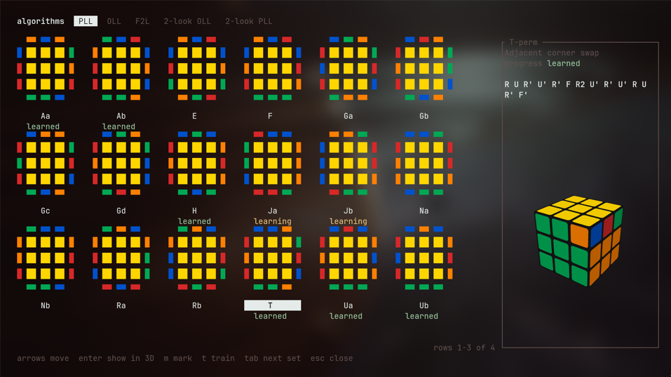

`a` opens the algorithm browser. `Tab` moves between PLL (21 cases), OLL (57), F2L (41),
2-look OLL and 2-look PLL; the arrows move between cases.

| Key | Action |
|---|---|
| arrows or `h` `j` `k` `l` | Move between cases |
| `Enter` or `v` | Show the case on the 3D cube; `space` there plays the algorithm |
| `m` | Mark the case: learning, learned, or back to new (saved) |
| `t` | Train this set |
| `Tab` / `Shift-Tab` | Next / previous set |
| `Esc` / `a` / `q` | Close |

Cases are shown the way they are learned: yellow on top, green in front, so orange is on
the right. OLL diagrams show only which stickers are yellow; F2L diagrams gray out the
last layer so the pair stands out, with the front face and its slot below.

**Trainer.** `t` in the browser drills the set: the cases you marked as learning, or all of
them if you haven't marked any. Every case comes up equally often, with the top layer
turned a random amount before and after it, and the rest of the last layer shuffled for OLL
and F2L so you can't spot a case from its scramble. Scrambles are for the cube held the WCA
way: scramble with white on top and green in front, turn it over (white cross down), and
the case is on top as the browser draws it. After each solve the timer names the case and
its algorithm. Training solves go into a separate session per set, tagged with their case,
so they don't mix with your normal times, and the browser shows your count, mean and best
for each case. `t` on the timer screen stops training.

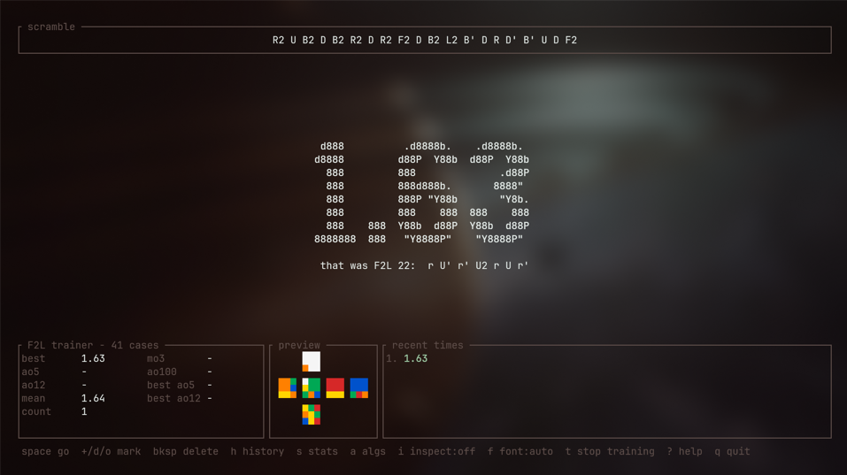

**Where the algorithms come from.** Each is the first algorithm
[SpeedCubeDB](https://www.speedcubedb.com/a/3x3) lists for the case. None is trusted on
sight: the tests check every one against the cube model. Every PLL must only permute the
last layer and every OLL keep the first two layers, and each set must solve every case
exactly once: the 288 possible last-layer permutations fall into the 21 PLLs, the 216
orientation patterns into the 57 OLLs, and the 150 places the front-right pair can be into
the 41 F2L cases. The case each diagram shows is computed from its algorithm, so a picture
can't disagree with the algorithm under it.

## The 3D view

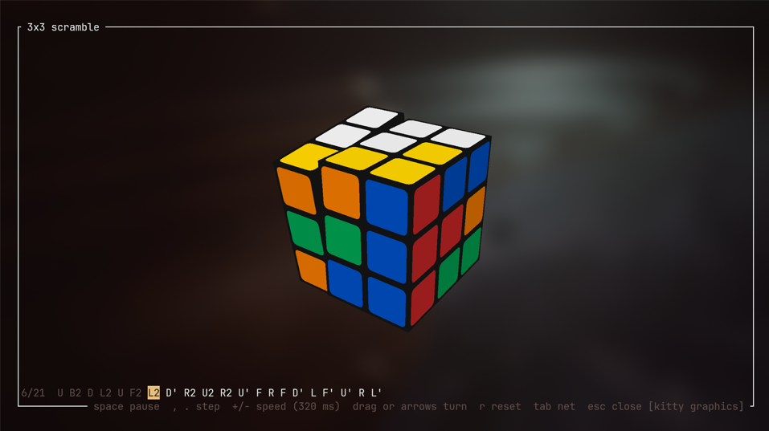

Press `v` on the timer screen for the current scramble, or in the history for that solve's
scramble.

| Key | Action |
|---|---|
| drag, arrows or `h` `j` `k` `l` | Turn the cube to look at it (hold an arrow to keep turning) |
| `r` | Back to the usual view: white on top, green in front |
| `space` | Play the scramble from a solved cube, move by move; again to pause |
| `,` / `.` | One move back / forward |
| `Home` / `End` | Solved / fully scrambled |
| `+` / `-` | Faster / slower |
| `m` | Change how the cube is drawn: image, half blocks, ASCII or mono ASCII (saved) |
| `Tab` | Switch between 3D and the flat net |
| `Esc` / `v` / `q` | Close |

How the cube is drawn depends on the terminal:

| Terminal | Drawn with |
|---|---|
| kitty, Ghostty | kitty graphics protocol |
| WezTerm | iTerm2 image protocol |
| foot | sixel |
| Alacritty and anything else | half-block characters (lower resolution, works everywhere) |

Press `m` to change the look, in this order: the image (only where the terminal can show
one), half blocks, ASCII and mono ASCII. Your choice is saved.

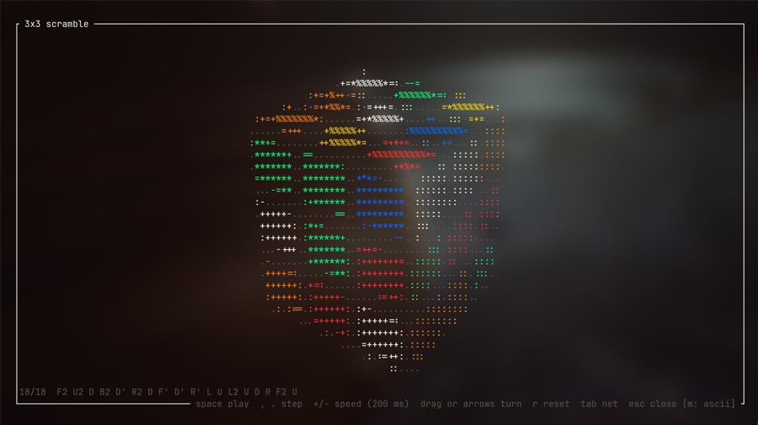

In ASCII the character comes from how brightly a face is lit, so the three visible faces
look different (`%` on top, `+` and `:` on the sides), and the stickers keep their colors;
mono ASCII drops the color. A character is a coarse pixel, so it is rougher than the
image, but it works in every terminal and over ssh.

The terminal is recognized from `TERM` and `TERM_PROGRAM`, without sending it queries.
Set `CUBETIMER_GRAPHICS` to `kitty`, `sixel`, `iterm2` or `halfblocks` to choose yourself,
for example for another terminal that supports one of those. tmux is untested.

The mouse is only captured while the 3D view is open; on every other screen the terminal
keeps it for selecting text.

## Scrambles

Each puzzle is scrambled the way TNoodle, the WCA's official scramble program, does it.

| Puzzle | Method |
|---|---|
| 2x2 | A uniformly random state out of all 3,674,160, kept only if it needs at least 4 moves (Regulation 4b3b). The scramble is the inverse of a random shortest solution, found from a table of the exact distance of every state, so it is as short as it can be (at most 11 moves). |
| 3x3 | A uniformly random state out of all 43 quintillion, kept only if it needs at least 2 moves (Regulation 4b3), solved with Kociemba's two-phase algorithm in at most 21 moves; the scramble is the inverse of that solution. Usually 19 to 21 moves. |
| 4x4 | 40 random moves: outer turns on every face and wide turns (`Uw`, `Rw`, `Fw`). |
| 5x5 | 60 random moves with outer and wide turns on every face. |
| 6x6 | 80 random moves; also `3Rw`-type turns, on R, U and F. |
| 7x7 | 100 random moves; `3Rw`-type turns on every face. |

Random-state scrambles make every state equally likely, which random moves can't promise.
For 5x5, 6x6 and 7x7 random moves *are* the WCA method. For 4x4 TNoodle uses a random
state; cubetimer uses random moves there (a random-state 4x4 needs a much larger solver),
so its 4x4 scrambles are good for practice but not identical to TNoodle's.

The 3x3 solver's tables take about 0.15 s to build when the program starts; the timer
shows at once and the first scramble appears a moment later. After that the next scramble
is prepared in the background while you solve. The 2x2 distance table (3.7 million states)
is built the first time you pick the 2x2, in about half a second, also in the background.

This is the same method, not the same program: for practice it is equivalent, but official
competitions must use TNoodle itself (Regulation 4b).

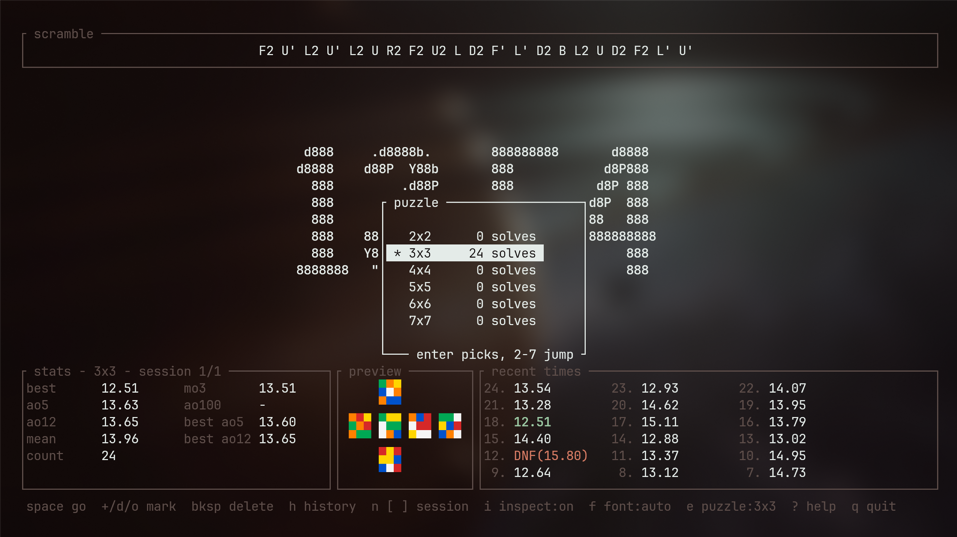

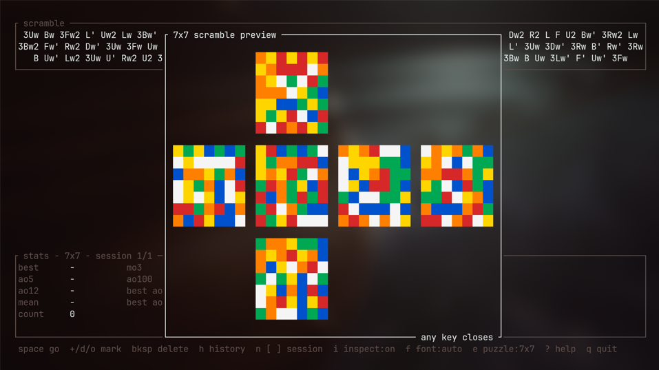

## Other terminals

cubetimer needs key *release* events for hold-to-start, which come from the
[kitty keyboard protocol](https://sw.kovidgoyal.net/kitty/keyboard-protocol/). It checks
for support at startup:

- **Supported**: hold and release to start.
- **Not supported**: it falls back to **basic mode**. A space press starts the timer and
  another stops it, and the footer says `basic mode`. (A terminal that never answers the
  capability query makes startup wait about two seconds before falling back.)

| Terminal | Status |
|---|---|
| kitty 0.49 | Tested: hold-to-start |
| foot 1.28 | Tested: hold-to-start |
| Alacritty 0.17 | Tested: hold-to-start |
| Ghostty 1.3 | Tested: hold-to-start |
| WezTerm | Tested: basic mode by default. For hold-to-start add `config.enable_kitty_keyboard = true` to `wezterm.lua` |
| Any terminal without the protocol | Tested on a bare pty: basic mode works end to end |

Each was checked end to end with the same physical key sequence: inspection,
hold-and-release start, stopping while holding the key, Shift+`=` for +2 and Shift+`/`
for help. Terminals disagree on some details (Ghostty and WezTerm send a held key's
auto-repeat as new presses; WezTerm leaves out Shift on shifted keys), and cubetimer
handles each of them.

If hold-to-start doesn't behave, run the key tester, hold space for a second and check
that you see a `Press` line and then a `Release` line (in between, kitty, foot and
Alacritty show `Repeat` lines; Ghostty and WezTerm show more `Press` lines):

```sh
cargo run --example keytest
```

(`KEYTEST_LOG=file` also writes the events to a file.)

The first line should say `keyboard enhancement: ON`.

## Limitations

- Cubes only: no Pyraminx, Skewb, Megaminx, Clock or Square-1.
- One algorithm per case, and only CFOP (no ZBLL, COLL or other methods). The trainer
  assumes a white cross and a yellow last layer.
- 4x4 scrambles are random-move, not random-state.
- No import from timers other than csTimer (export to CSV is supported), and no Bluetooth
  smart cubes.
- The scramble preview and the 3D view use true color (24-bit), which every terminal
  listed above supports.
- The 3D view hasn't been tried inside tmux.

## Development

```sh
cargo test                 # cube models, solvers, scrambles, formatting, stats, fonts, state machine, layouts
cargo clippy --all-targets -- -D warnings
cargo run --example keytest
cargo run --release --example scramblebench -- 2000   # solver speed and scramble lengths
```

The code is split by job: `cube.rs` (the 3x3 at the piece level), `twophase.rs` (the 3x3
solver), `nxn.rs` (cubes of any size as stickers in space), `twobytwo.rs` (the 2x2 state
table), `puzzle.rs`, `scramble.rs`, `fmt.rs` (time formatting), `stats.rs` (averages), `font.rs`
(digit fonts), `store.rs` (sessions on disk), `app.rs` (state machine), `ui.rs`
(drawing), `render3d.rs` (the 3D renderer), `anim.rs` (playing moves), `view3d.rs` (the 3D
view), `chart.rs` (axis ticks, outliers, histograms), `statsview.rs` (the statistics
screen and the chart), `import.rs` (csTimer files), `alg.rs` (algorithm notation), `algs.rs` (the algorithm library and
its checks), `algview.rs` (the browser) and `trainer.rs`. `term.rs` owns raw mode and the keyboard protocol, and restores the terminal on
exit, on panic and on signals.

## License

[MIT](LICENSE)
